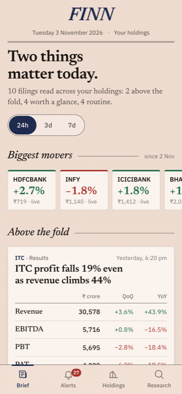
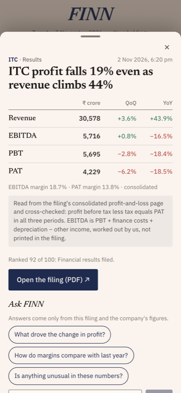
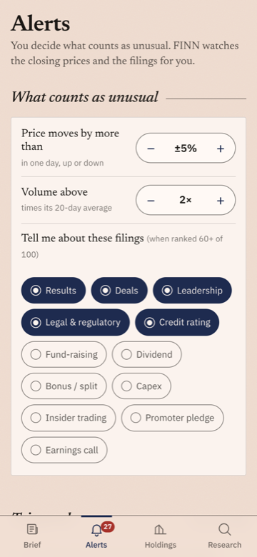
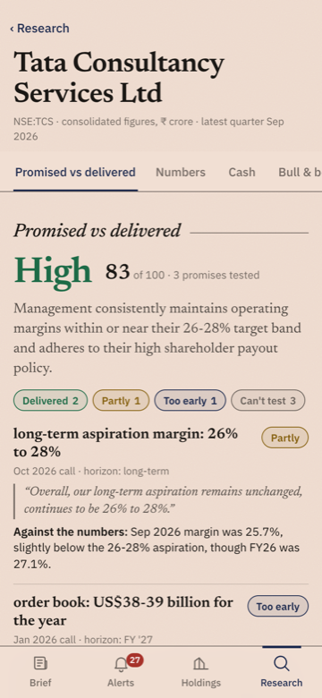

# FINN: a financial investment agent for your phone

FINN watches a portfolio of NSE stocks and does two things.

- **Push.** It tells you what changed and why you should care: a windowed brief of corporate filings, ranked so the few that
  matter come first and the routine ones fold away, plus alerts that fire when *your* thresholds are crossed.
- **Pull.** You name any NSE ticker and it researches it from primary sources only (reported financials and earnings-call
  transcripts), including a check of what management promised against what the numbers later showed.

<table><tr>
<td></td>
<td></td>
<td></td>
<td></td>
</tr></table>

The interface is deliberately an Indian financial newspaper's front page: pink paper, serif headlines, a visible fold. The
brief is the product's point of view: *filtering*, not aggregation. Routine paperwork is folded under a crease you can open.

## What's in the app

| Tab | What it does |
|---|---|
| **Brief** | A headline written from the data ("Six things matter today."), a 24h / 3d / 7d window, a strip of the biggest movers, then **Above the fold** (results cards with a Revenue / EBITDA / PBT / PAT table with QoQ and YoY; management cards that show the people), **Worth a glance** one-liners, and a paper-fold crease hiding the routine filings. |
| **Filing sheet** | Tap any card: full detail, why it was ranked, the filing PDF, and **Ask FINN** with suggested questions. |
| **Alerts** | Steppers for the price move (±X%) and volume multiple (N× the 20-day average), toggles for the filing types you follow, then what has triggered. Changing a limit re-derives the alerts immediately. |
| **Holdings** | The 18 stocks with sparklines, last close and move; tap for a stock page. |
| **Research** | Any NSE symbol. Sticky section tabs: **Promised vs delivered**, numbers (with charts), cash, bull & bear, Ask FINN. |

## Architecture

```
 NSE corporate-announcements API ─┐                           ┌─ Brief / Alerts / Holdings / Research
 Yahoo Finance (yfinance, .NS) ───┼─► refresh.py ─► SQLite ─► FastAPI ─► React (Vite) mobile web app
 screener.in (tables, transcripts)┘      │            ▲         │
                                         ▼            │         └─► serves the built app on one port
        rules.py  ─► classify (regex, ordered)        │
        llm.py    ─► cheap model: unmatched filings,  │   every LLM call is cached by hash in `llm_cache`
                     results tables, mgmt changes,    │
                     one-line summaries, promises     │
        enrich.py ─► Python does the maths (EBITDA, QoQ/YoY, self-check)
        alerts.py ─► thresholds from the `settings` table
        facts.py  ─► research numbers, no LLM ─► research.py ─► strong model: judge promises, bull/bear
```

```
backend/   FastAPI + SQLite     rules.py classify.py enrich.py alerts.py prices.py announcements.py
                                screener.py facts.py research.py llm.py pdfs.py refresh.py main.py db.py config.py
frontend/  React + Vite         Brief, Alerts, Holdings, Research, Sheet, AskFinn, charts (hand-written SVG)
data/seed/ finn.db              committed snapshot so a fresh deploy is never empty
```

## Model routing and cost

The brief asks for cheap models on bulk work and a stronger one only where reasoning demands it. Most of the pipeline uses
**no model at all.**

| Step | How | Model |
|---|---|---|
| Classify filings into 17 categories | Ordered regex rules + keyword nudges, first match wins. **~92% of filings never reach a model.** | none |
| Filings the rules can't place | Batched, 25 per call | cheap |
| Results table (revenue, other income, finance costs, depreciation, PBT, tax, PAT × 3 periods) | Python finds the P&L page, the model only *transcribes* it; EBITDA, QoQ, YoY and margins are computed in Python | cheap, **strong only if the self-check fails** |
| Management changes (people, role, effective date, bio from the annexure) | Whole filing if short, else the pages that mention appointments | cheap |
| One-line summaries (≤18 words) | 20 filings per call | cheap |
| Research numbers, CAGR, margins, debt/equity, working capital, cash conversion, observations | scraped from screener.in and computed in Python | none |
| Promises: extract from concall transcripts | A keyword filter cuts a ~46k-character transcript to ~2k of candidate paragraphs first | cheap |
| Promises: judge against reported numbers | One call over all promises and the numbers | **strong** |
| Bull / bear | One call over the computed facts | **strong** |
| Ask FINN | Context is only the filing and/or company data | cheap |

Tiers map onto Gemini by default (`gemini-3.5-flash-lite` cheap with thinking off, `gemini-3-flash-preview` strong). Set
`ANTHROPIC_API_KEY` instead and they map to Haiku and Sonnet. Override with `FINN_GEMINI_CHEAP` / `FINN_GEMINI_STRONG`.

Caching: every call is keyed on a hash of model + prompt in `llm_cache`, so re-runs cost nothing; research sections are cached
for 7 days; PDFs and their extracted text are cached on disk. For the whole demo universe (114 filings, a handful of research
runs) the cache holds **59 calls, about 127k input and 15k output tokens**, which fits a free tier.

## Judgment calls

1. **Rules before models.** A regex ladder with a base priority and a one-line "why" per rule is auditable, free and instant.
   A model sees only what the rules can't place, and an invalid model answer is clamped to low priority rather than trusted.
2. **Priority is a score, not a label.** Rules give a base (results 92, CEO/CFO change 86, M&A 80, dividend 40, ESOP 5), then
   nudges adjust it ("downgrade" +45, "warning letter" +18). Tiers: ≥60 above the fold, 35 to 59 worth a glance, below that folded.
3. **One event, one card.** Several filings from the same company, category and day collapse into the strongest, with a
   "+2 related" note, in both the brief and the alerts.
4. **The model transcribes, Python reasons.** For results, the model only copies a table. EBITDA, growth and margins are computed
   in code, and `PBT − tax ≈ PAT` is checked. A failure retries on the strong model once, and a second failure is flagged
   `needs_review` and shown without figures, never guessed. A guard also flags values with 3+ decimals, which catches
   scanned PDFs whose thousands separators were misread as decimal points (this actually happened on Maruti).
5. **Promises are checkable.** Extracted quotes must appear verbatim in the transcript or they are dropped. The judge may answer
   *delivered / partly / missed / too early*, plus **unverifiable** (my addition) when a promise can't be measured from the
   tables or doesn't say what it applies to. The score and the high/mixed/low rating are arithmetic on the verdicts, not model output.
6. **Bull and bear can only cite computed facts.** Each point names a fact key and the displayed number comes from our data, not the
   model's prose. If the data supports fewer than three honest points, fewer are shown.
7. **Ask FINN refuses.** It answers in ≤90 words from the supplied filing and company data only, says what is missing when the
   answer isn't there, and never uses outside knowledge or gives advice.
8. **Banks and NBFCs are different.** For lenders, operating margin, debt/equity and cash conversion are not meaningful and are
   suppressed; gross NPA and return on equity are shown instead.
9. **Primary sources only on the pull side.** No news, broker notes or the model's own knowledge of a company.
10. **Honest about time.** The intraday bar is flagged "live" before 15:45 IST, and volume multiples on it are partial.
    Loading states say what is happening ("Reading 5 earnings-call transcripts…") with an elapsed counter.

## Run it

Requires Python 3.9+ (developed and tested on 3.9), Node 18+ and an LLM key (a free Gemini key is fine).

```bash
cp .env.example .env        # paste your GEMINI_API_KEY after the =
./run.sh                    # creates .venv, installs, refreshes data, builds the frontend, serves on :8000
```

Open `http://localhost:8000`, or the `http://<computer-ip>:8000` it prints on a phone on the same wifi.
`./run.sh --no-refresh` restarts quickly; `PORT=9000 ./run.sh` changes the port. Without a key everything that doesn't need a
model still works (prices, filings, rule-based ranking, alerts, the research numbers and charts).

Pieces on their own:

```bash
.venv/bin/python -m backend.refresh [SYMBOL ...] [--days 7]     # prices + filings + classify + enrich + alerts
.venv/bin/python -m backend.enrich [results|mgmt|summaries] [--limit N] [--force] [--all-stocks]
.venv/bin/python -m backend.classify [--redo] [--no-llm]
cd frontend && npm run dev                                      # hot-reloading UI on :5173, proxies /api to :8000
```

## Deploy

The app is one process serving the API and the built UI, so any host that runs a Docker container works. (The `Dockerfile` is
written but I could not build it where I developed this; what I did verify is the same start-up from a clean directory with only
the container's contents: install from `requirements.txt`, boot from the seed with no database, serve the UI and deep links.)

```bash
docker build -t finn . && docker run -p 8000:8000 -e GEMINI_API_KEY=... -e FINN_AUTO_REFRESH_HOURS=3 finn
```

**Render (free, no CLI):** push to GitHub, then *New → Web Service → connect the repo → Runtime: Docker*. Add the environment
variables `GEMINI_API_KEY` and `FINN_AUTO_REFRESH_HOURS=3`. Render gives you `https://<name>.onrender.com`.
Free instances sleep after 15 minutes idle (first load takes ~1 minute) and their disk is wiped on each restart, which is why
the container starts from `data/seed/finn.db` and, with `FINN_AUTO_REFRESH_HOURS` set, refreshes itself in the background.
For persistence, attach a disk and set `FINN_DB=/var/data/finn.db`.

Caveat: NSE sometimes blocks cloud IP ranges. If the hosted refresh logs show NSE failures, the app keeps serving the seed
snapshot; to demo live data, run `./run.sh` on a laptop and expose it with a tunnel (`cloudflared tunnel --url http://localhost:8000`).

## API

| Endpoint | |
|---|---|
| `GET /api/digest?hours=24` | top / look / routine-by-company / movers / quiet holdings |
| `GET /api/alerts`, `POST /api/alerts/{id}/seen` | triggered alerts |
| `GET`/`PUT /api/settings` | thresholds and followed categories; PUT re-derives alerts |
| `GET /api/holdings`, `GET /api/stock/{symbol}`, `GET /api/announcement/{id}` | data for the screens |
| `GET /api/research/{symbol}` | computed sections + plain-English observations (no LLM) |
| `GET /api/research/{symbol}/promises` | promised vs delivered |
| `GET /api/research/{symbol}/bullbear` | 3 bull + 3 bear, each tied to a computed number |
| `POST /api/ask` `{question, symbol?, ann_id?}` | grounded answer, ≤90 words |

## What I left out, and what's next

- **Business snapshot** (what the company does, segments, revenue mix) and **annual-report grounding**: the pull side currently uses
  screener.in's tables and concall transcripts, not the annual report PDFs.
- **Management bios from outside the filing** (the brief's LinkedIn example). Bios come only from the filing's own annexure,
  and are blank when it has none.
- **Credit-rating direction.** A downgrade vs an upgrade is only in the rating letter's PDF, so rating filings get a flat priority for now.
- **Concall coverage depends on screener.in.** Some companies (ITC, Trent) list no transcript links, and some company-hosted
  links block scripts. The app says so instead of guessing.
- **Scanned PDFs** are not OCR'd; a scan with no text layer is marked unavailable.
- **Real-time push** (web push / notifications): alerts are evaluated on refresh, not delivered to the lock screen.
- **Promise judging is the weakest link.** It is only as good as the quote's context; a perfect score means "no contradiction
  found", not proof. Next step would be giving the judge the surrounding paragraph and a per-company metric glossary.
